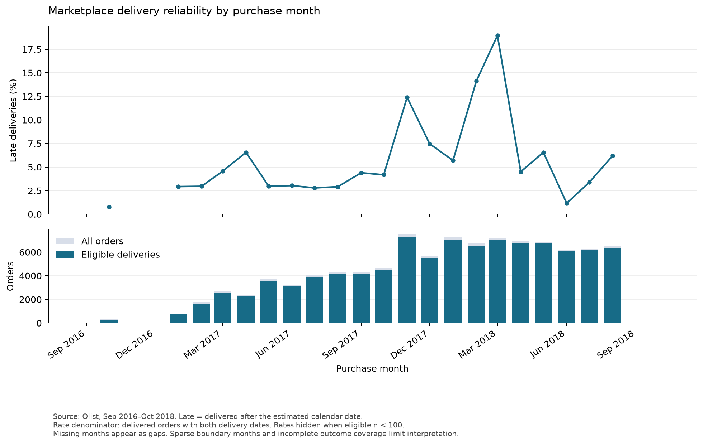

# marketplace-SQL-analytics
SQL-first analysis of marketplace delivery reliability and customer outcomes using DuckDB, Python, and Olist data.

The reporting pass is complete: three figures, three findings, exported result tables,
and current-data validation. March 2018 had an 18.96% late-delivery rate among
7,003 eligible deliveries. Review timing substantially changes the delay–review
comparison. The eight largest destination-state groups account for 80.61% of late
orders among states meeting the support threshold. Read the
[findings and limitations](reports/findings.md).

Skills: SQL joins, CTEs, conditional aggregation, window functions, data modeling,
reconciliation, DuckDB, and Python visualization.

## Current file structure

The project separates reusable SQL models from learning queries and validation checks. Some earlier scripts still combine model definitions and analysis.

| File | Current purpose | Run after |
| --- | --- | --- |
| `SQL/profile_sources.sql` | Explore source schemas, keys, and relationships | No model prerequisite |
| `SQL/profile_reviews.sql` | Explore review cardinality and selection | No model prerequisite |
| `SQL/order_analytics.sql` | Define the reusable `order_analytics` temporary view, one row per order | No model prerequisite |
| `SQL/practice_order_analytics.sql` | Order-model learning and exploratory queries | No model prerequisite |
| `SQL/check_order_analytics.sql` | Inspect order counts, coverage, and monetary reconciliation | `order_analytics.sql` |
| `SQL/region_analytics.sql` | Define only the reusable `order_region_analytics` temporary view, adding customer destination state | `order_analytics.sql` |
| `SQL/practice_region_analytics.sql` | Regional profiling, review comparisons, timing sensitivity, rankings, and cumulative-share practice | `order_analytics.sql`, then `region_analytics.sql` |
| `SQL/check_region_analytics.sql` | Seven checks covering order population, geography, merchandise values, and delivery/review outcomes | `order_analytics.sql`, then `region_analytics.sql` |
| `SQL/order_seller_analytics.sql` | Define order-seller views and run seller analyses | `order_analytics.sql` |
| `SQL/review_outcomes.sql` | Compare review outcomes by delivery delay and review timing | `order_analytics.sql` |
| `SQL/delivery_reliability.sql` | Explore delivery coverage, lateness, and purchase-month summaries directly from source data | No model prerequisite |
| `SQL/monthly_delivery_trends.sql` | Monthly rates, coverage, previous observed rates, calendar-month changes, and support flags | `order_analytics.sql` |

`run_duckdb.py` executes the supplied SQL files in order on one DuckDB connection. Temporary views last only for that connection, so dependent files must be passed in the same invocation. Paths are relative to the repository root; raw CSVs belong in `data/raw/`.

## Running the current SQL

From the repository root, with the existing local virtual environment containing DuckDB:

```bash
# Build the order and regional views, then check regional order uniqueness.
.venv/bin/python run_duckdb.py \
    SQL/order_analytics.sql \
    SQL/region_analytics.sql \
    SQL/check_region_analytics.sql

# Build the same views, then display the regional practice results.
.venv/bin/python run_duckdb.py \
    SQL/order_analytics.sql \
    SQL/region_analytics.sql \
    SQL/practice_region_analytics.sql

# Inspect order-level coverage and monetary reconciliation.
.venv/bin/python run_duckdb.py \
    SQL/order_analytics.sql \
    SQL/check_order_analytics.sql
```

The regional duplicate check should return column headers with no data rows. This means no duplicate order IDs were found; it does not establish that all source orders were retained. The runner displays query results rather than automatically asserting that checks pass.

Direct dependencies are pinned in `requirements.txt`; the local environment uses Python 3.11.6. See [data/README.md](data/README.md) for data provenance, [PROJECT_PLAN.md](PROJECT_PLAN.md) for the intended release, and [AGENTS.md](AGENTS.md) for SQL coaching preferences.

## Figures and findings

Read [the findings report](reports/findings.md) for quantitative results, denominators, and limitations.

```bash
python3 -m venv .venv
.venv/bin/python -m pip install -r requirements.txt
.venv/bin/python make_figures.py
```

Download and extract the Olist CSVs into `data/raw/` first (see [data provenance](data/README.md)). Figure generation uses a noninteractive Matplotlib backend and writes three PNGs in `figures/` plus five SQL result CSVs in `reports/results/`. It reuses the monthly, review, and regional SQL; the regional script still contains learning queries. The local environment is verified; an isolated fresh install has not yet been tested.



Additional figures: [review outcomes and timing sensitivity](figures/review_outcomes.png), [regional priorities](figures/regional_priorities.png).

The first analysis covers time, reviews, and destination states. Category comparisons and synthetic edge-case tests remain future work; this is an independent learning project, not a production pipeline.

## Current-data validation

```bash
.venv/bin/python validate_analysis.py
```

This runner exits nonzero on regional check failures, order monetary reconciliation
failures, or monthly population/rate/support inconsistencies. It checks the actual
local dataset, rather than synthetic edge cases. See the
[data dictionary](reports/data_dictionary.md) for grains and metric definitions.
