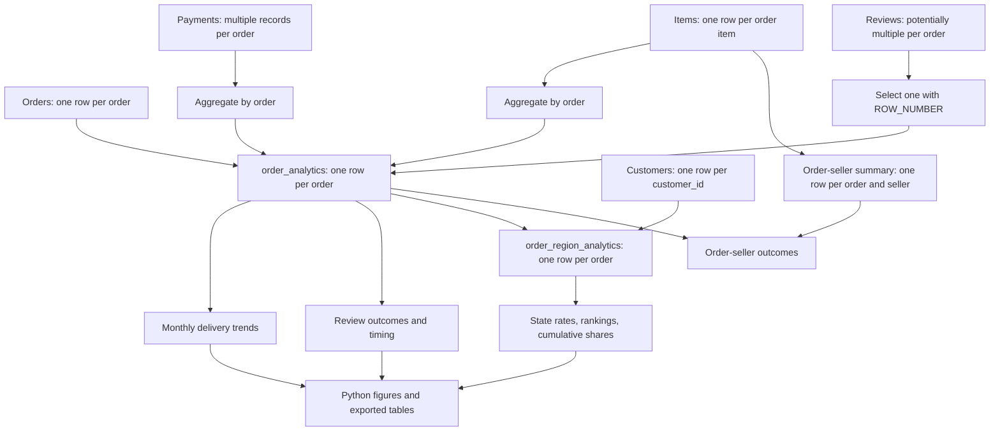

# Models and query guide

## Data flow



Items and payments are aggregated independently to avoid multiplying monetary values. Review selection uses the latest answer timestamp, then review ID ascending. Left joins preserve orders with absent related records. Regional joins use the order-linked `customer_id`.

## Query inventory

Paths are relative to the repository root. Run dependencies on the same connection using `run_duckdb.py`.

| SQL file | Purpose | Prerequisites |
| --- | --- | --- |
| `profile_sources.sql` | Source schema, key, and relationship inspection | None |
| `profile_reviews.sql` | Review cardinality and selection inspection | None |
| `order_analytics.sql` | Reusable order model | None |
| `check_order_analytics.sql` | Coverage and monetary reconciliation | Order model |
| `monthly_delivery_trends.sql` | Monthly rates, coverage, changes, support flags | Order model |
| `review_outcomes.sql` | Delay/review comparisons and timing sensitivity | Order model |
| `region_analytics.sql` | Reusable destination-state model | Order model |
| `check_region_analytics.sql` | Seven regional preservation checks | Order and regional models |
| `practice_region_analytics.sql` | State profiling, comparisons, rankings, cumulative shares | Order and regional models |
| `order_seller_analytics.sql` | Order-seller models and supporting seller analyses | Order model |
| `delivery_reliability.sql` | Source-based delivery exploration | None |
| `practice_order_analytics.sql` | Incremental exploration of the order model | None |

All files above are in `SQL/`. The two `practice_` files retain exploratory work. Reporting executes the regional file and selects its state delivery summary by output columns; other outputs are not plotted. Its state review comparisons and rankings remain available for inspection. Seller queries include a specific-order inspection as well as aggregate summaries and are not part of the three headline findings.

## Example execution

```bash
.venv/bin/python run_duckdb.py SQL/order_analytics.sql SQL/check_order_analytics.sql
.venv/bin/python run_duckdb.py SQL/order_analytics.sql SQL/review_outcomes.sql
.venv/bin/python run_duckdb.py SQL/order_analytics.sql SQL/region_analytics.sql SQL/practice_region_analytics.sql
```

The display runner does not assert success. Use `validate_analysis.py` for automatic full-data validation.

## Analytical decisions

- **Grain:** calculate order outcomes once per order. Seller rows share the order outcome; summed seller order counts are not unique marketplace orders.
- **Delivery denominator:** delivered orders with both actual and estimated dates. Compare calendar dates; retain ineligible orders for coverage summaries.
- **Review denominator:** reviewed eligible orders in the specified comparison. Missing reviews are not favorable outcomes.
- **Time comparisons:** an observed-row `LAG()` can cross missing months; calendar-month changes require adjacency.
- **Regional priorities:** minimum support is 100 eligible deliveries. Rate rankings and counts answer different operational questions.
- **Interpretation:** review timing changes the analyzed population. Destination state does not identify seller or carrier responsibility.
