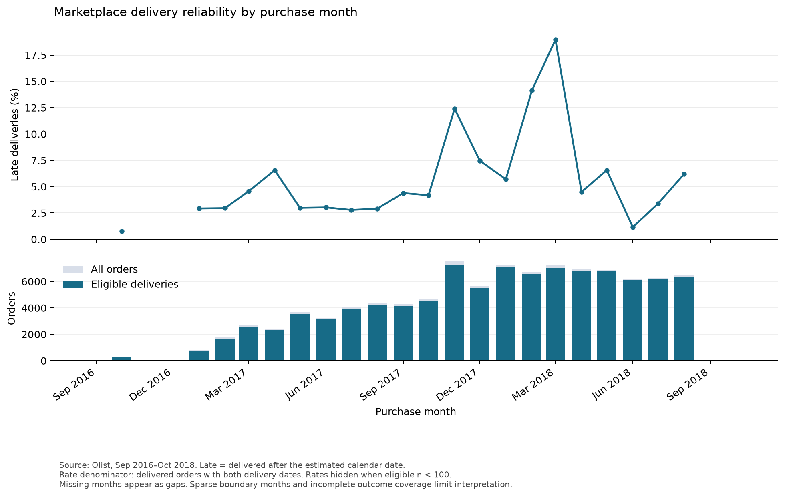
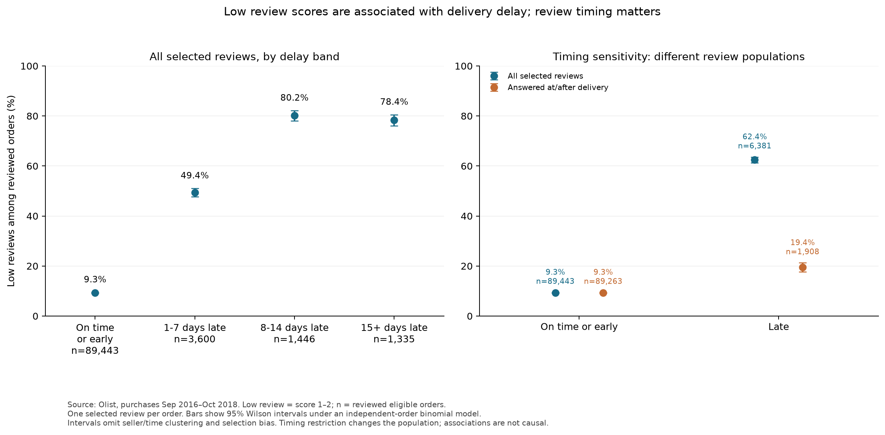
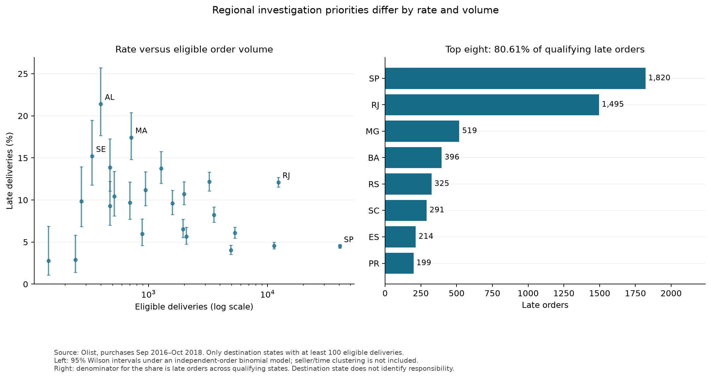

# Marketplace delivery reliability findings

## Delivery reliability varied over time

Among purchase months with at least 100 eligible deliveries,
March 2018 had the highest observed late-delivery rate:
1,328 of 7,003 eligible deliveries (18.96%).

The rate increased by 4.84 percentage points from February 2018.
Eligible deliveries represented 97.12% of March's 7,211 orders.

This suggests investigating which sellers, destinations, and
product groups contributed to the elevated rate. The monthly
comparison alone does not identify its cause.

Rates use delivered orders with both actual and estimated delivery
dates, comparing calendar dates. Sparse months are excluded from
the plotted rates. Historical boundary months and incomplete
outcome coverage limit interpretation.

## Low reviews were associated with delays, with substantial timing sensitivity

Among reviewed eligible deliveries, 3,983 of 6,381 late orders received a score of 1–2
(62.42%; 95% Wilson interval 61.22–63.60%), compared with 8,289 of 89,443 on-time
or early orders (9.27%; 9.08–9.46%). Review coverage was 97.66% among late orders
and 99.45% among on-time orders. Low-review rates by delay band were 49.39% for
1–7 days late, 80.15% for 8–14 days late, and 78.35% for 15 or more days late;
the relationship is not strictly increasing across these bands.

However, 4,473 of the 6,381 reviewed late orders were reviewed before delivery.
Restricting to reviews answered at or after delivery leaves 1,908 late orders,
of which 371 received a low score (19.44%; 17.73–21.28%). The corresponding
on-time rate is 9.25% (8,258 of 89,263; 9.06–9.44%). The timing restriction
therefore changes the population substantially, rather than simply correcting
an otherwise identical comparison. Customers reviewing before delivery may have
been dissatisfied while still waiting.

Investigating the customer experience while orders remain outstanding is a useful
next question. These comparisons do not estimate a causal effect of delay: review
selection, seller mix, product mix, and purchase period can affect the association.
Reviews are selected deterministically using the latest answer timestamp, then
review ID ascending for ties. Outcomes are analyzed once per order.

Source query: [review_outcomes.sql](../SQL/review_outcomes.sql).
Reproducible tables: [delay bands](results/review_delay_bands.csv),
[all reviews](results/review_all.csv), and
[at/after delivery](results/review_at_or_after_delivery.csv).

## Regional priorities differ depending on rate versus volume

Among 24 destination states with at least 100 eligible deliveries, SP had the most
late orders: 1,820 of 40,494 eligible deliveries (4.49%; 95% Wilson interval
4.30–4.70%). AL had the highest late-delivery rate: 85 of 397 (21.41%;
17.66–25.71%). RJ combined substantial volume and a higher rate: 1,495 of 12,350
(12.11%; 11.54–12.69%). The smaller AL sample produces a wider interval.

The eight states with the most late orders—SP, RJ, MG, BA, RS, SC, ES, and PR—
accounted for 5,259 of the 6,524 late orders in qualifying states (80.61%).
There were 6,534 late orders across the full eligible population, so the share
uses a restricted denominator, not the marketplace-wide total.

An investigation prioritizing affected order volume would start with different
states than one prioritizing unusually high rates. Destination state alone cannot
identify seller or carrier responsibility. These are historical aggregate comparisons;
route, seller, category, and time differences remain possible explanations.

Source query: state delivery summary in
[practice_region_analytics.sql](../SQL/practice_region_analytics.sql).
Reproducible table: [regional delivery](results/regional_delivery.csv).

## Methods, validation, and limits

- The order model retains 99,441 source orders. Of these, 96,470 have eligible
  delivery outcomes, including 6,534 late deliveries (6.77%).
- Items and payments are aggregated separately before joining. Merchandise,
  freight, and payment totals reconcile to their CSV sources. Merchandise value
  is not platform revenue or profit.
- Regional checks cover duplicate, missing, and extra order IDs; missing states;
  merchandise total and per-order preservation; and delivery/review preservation.
- Monthly counts reconcile to the order population. Previous-observed changes are
  distinguished from consecutive-calendar-month changes. A comparison support flag
  requires 100 eligible deliveries in both adjacent months; it does not certify
  statistical reliability or complete follow-up.
- Wilson intervals use a binomial model treating orders as independent. They are
  descriptive model-based summaries of this historical extract, not uncertainty
  about its observed counts. They do not include seller/customer/time clustering,
  multiple-comparison effects, missingness, selection bias, or future performance.
- All findings are observational. No operational intervention or business impact
  has been tested. Category-adjusted comparisons and synthetic edge-case tests
  are not included in this reporting pass.

Reproduce all figures and result tables with `python make_figures.py` after setup.
Run `python validate_analysis.py` to check the current full-data pipeline.
See [data dictionary](data_dictionary.md), [monthly SQL](../SQL/monthly_delivery_trends.sql),
and [monthly results](results/monthly_delivery_trends.csv).
